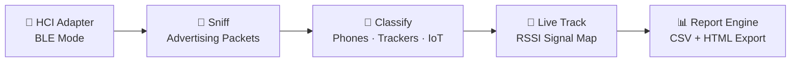
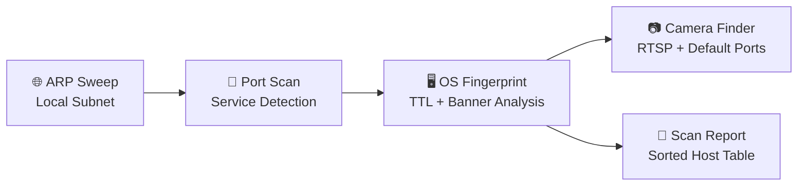
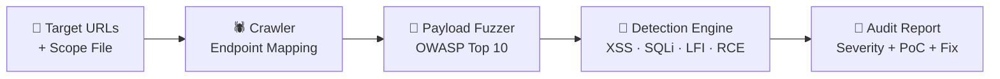
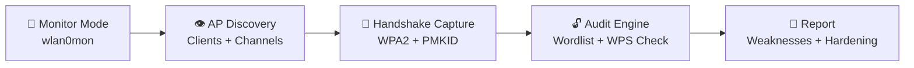
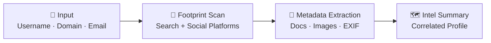
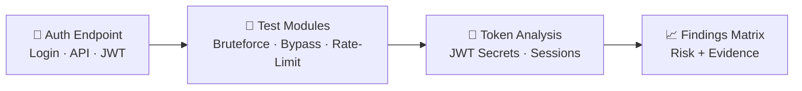
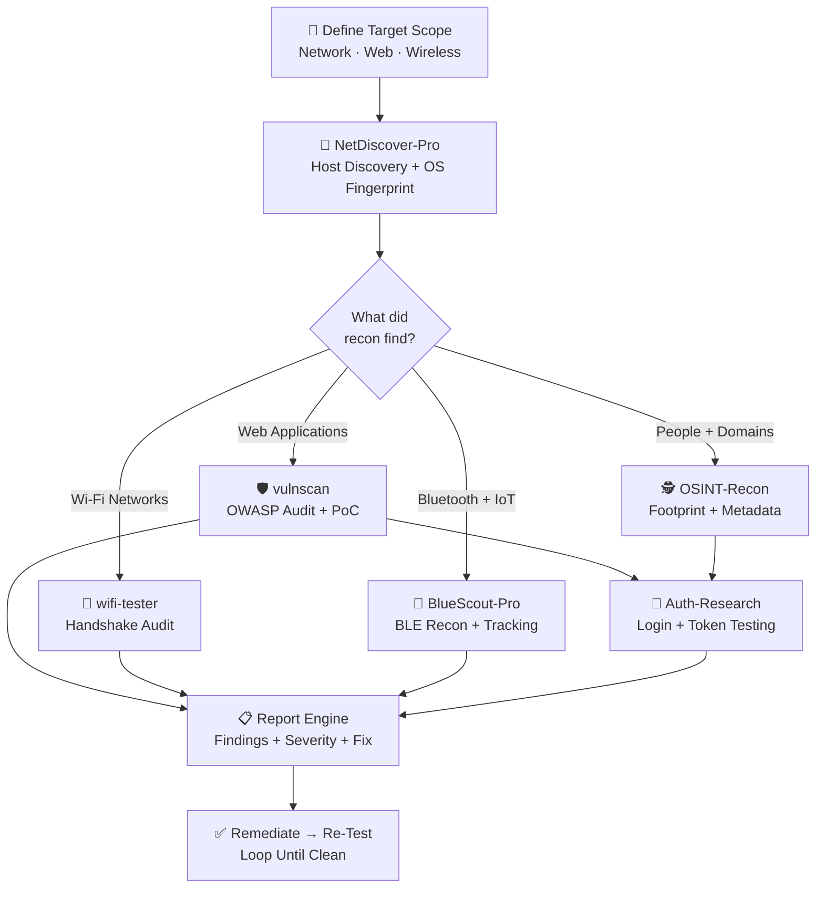

<a name="top"></a>
<div align="center">

<!-- ═══════════════════ HERO ANIMATION ═══════════════════ -->


<!-- ═══════════════════ TYPING ANIMATION ═══════════════════ -->
<a href="https://github.com/ahirankush771">
  
</a>

<br/>

<!-- ═══════════════════ QUICK BADGES ═══════════════════ -->


</div>

---

## ⚡ Terminal Overview

```bash
┌──(root㉿ankush-sec)-[~]
└─# whoami
❯ Identity       : Ankush Kumar
❯ Handle         : @ahirankush771
❯ Title          : Ethical Hacker & Cyber Security Researcher
❯ Core Arsenal   : Network Pentest · Vulnerability Research · Exploit Tooling
❯ Target Focus   : Advanced Pentesting · Malware RE · Red Teaming
❯ Current Ops    : Building automated security tools & research suites 🛡️

└─# cat /etc/mission
❯ Find weaknesses before attackers do — then build the tools that automate it.
```

<div align="center">

**⚡ [Featured Tools](#-featured-arsenal) · 🧭 [Quick Start](#-quick-start) · 🧰 [Tool Deep Dives](#-tool-deep-dives) · 🗺️ [Recon Map](#-recon-pipeline-map) · 🛠️ [Arsenal](#-arsenal-and-technologies) · 📊 [Stats](#-github-analytics) · 🌐 [Connect](#-connect-and-network)**

</div>

---

## 🚀 Featured Arsenal

> **Hand-built security tooling — recon, auditing & reporting. Best stuff first.**
> If a tool saves you time on an engagement, drop it a ⭐ — it keeps the research going.

<div align="center">
<table>
<tr>
<td width="50%" valign="top">

<h3 align="center">🔵 BlueScout-Pro</h3>
<p align="center"><b>Advanced Bluetooth Recon & Monitoring</b><br/>
<sub>BLE device detection · live tracking · report engine</sub></p>
<p align="center">
  
  
  
  
</p>
<p align="center">
  <a href="https://github.com/ahirankush771/BlueScout-Pro"></a>
  <a href="#-bluescout-pro"></a>
</p>

</td>
<td width="50%" valign="top">

<h3 align="center">📡 NetDiscover-Pro</h3>
<p align="center"><b>High-Speed Network Scanner & Mapper</b><br/>
<sub>OS fingerprinting · open-port analyzer · camera discovery</sub></p>
<p align="center">
  
  
  
  
</p>
<p align="center">
  <a href="https://github.com/ahirankush771/NetDiscover-Pro"></a>
  <a href="#-netdiscover-pro"></a>
</p>

</td>
</tr>
<tr>
<td width="50%" valign="top">

<h3 align="center">🛡️ vulnscan</h3>
<p align="center"><b>Automated Web Vulnerability Assessment</b><br/>
<sub>OWASP audit suite · severity scoring · PoC reports</sub></p>
<p align="center">
  
  
  
  
</p>
<p align="center">
  <a href="https://github.com/ahirankush771/vulnscan"></a>
  <a href="#-vulnscan"></a>
</p>

</td>
<td width="50%" valign="top">

<h3 align="center">📶 wifi-tester</h3>
<p align="center"><b>Wi-Fi Analysis & Handshake Audit Framework</b><br/>
<sub>AP discovery · WPA2/PMKID auditing · Linux + Termux</sub></p>
<p align="center">
  
  
  
  
</p>
<p align="center">
  <a href="https://github.com/ahirankush771/wifi-tester"></a>
  <a href="#-wifi-tester"></a>
</p>

</td>
</tr>
<tr>
<td width="50%" valign="top">

<h3 align="center">🕵️ OSINT-Recon</h3>
<p align="center"><b>Digital Footprint & Intelligence Gatherer</b><br/>
<sub>Automated footprinting · metadata inspection · social intel</sub></p>
<p align="center">
  
  
  
  
</p>
<p align="center">
  <a href="https://github.com/ahirankush771?tab=repositories"></a>
  <a href="#-osint-recon"></a>
</p>

</td>
<td width="50%" valign="top">

<h3 align="center">🔑 Auth-Research</h3>
<p align="center"><b>Authentication Mechanism Test Kit</b><br/>
<sub>Login abuse testing · JWT & session analysis · access controls</sub></p>
<p align="center">
  
  
  
  
</p>
<p align="center">
  <a href="https://github.com/ahirankush771?tab=repositories"></a>
  <a href="#-auth-research"></a>
</p>

</td>
</tr>
</table>
</div>

---

## 🧭 Quick Start

**Environment prerequisites** — every tool below assumes this baseline:

| Requirement | Details |
| :--- | :--- |
| 🐧 **OS** | Kali Linux · Ubuntu · Parrot · Termux (Android) |
| 🐍 **Runtime** | Python 3.10+ (`python3 --version`) |
| 🛰️ **Scanner** | Nmap — powers deep service scans in NetDiscover-Pro |
| 🔑 **Privileges** | `sudo` / root — needed for raw sockets & monitor mode |

```bash
# One-time environment setup (Kali / Ubuntu)
sudo apt update && sudo apt install -y python3 python3-pip nmap git
```

> ⚠️ **Ethical use only** — these tools are built for authorized testing, labs & CTFs.
> Never run them against systems you do not own or have written permission to test.

---

## 🧰 Tool Deep Dives

*Every tool: what it does → how it works (flow) → how to use it (commands).*

### 🔵 BlueScout-Pro — Bluetooth Recon & Monitoring Toolkit

> Detect, classify and **live-track** BLE devices around you — then export everything into a clean recon report.

**How it works:**



**How to use:**

```bash
# 1) Clone + install
git clone https://github.com/ahirankush771/BlueScout-Pro.git
cd BlueScout-Pro && pip install -r requirements.txt

# 2) One-shot BLE recon sweep (needs a Bluetooth adapter)
sudo python bluescout.py --scan

# 3) Live device tracking — real-time RSSI feed, filter by class
sudo python bluescout.py --live --filter trackers

# 4) Export findings as a clean HTML report
sudo python bluescout.py --scan --report html
```

---

### 📡 NetDiscover-Pro — High-Speed Network Scanner

> Map **every host** on a local network: OS guesses, open ports, and sneaky IP cameras — in one sweep.

**How it works:**



**How to use:**

```bash
# 1) Clone + install
git clone https://github.com/ahirankush771/NetDiscover-Pro.git
cd NetDiscover-Pro && pip install -r requirements.txt

# 2) Full local network sweep — hosts + OS + open ports
sudo python netdiscover.py --range 192.168.1.0/24

# 3) Hunt for IP cameras on the network
sudo python netdiscover.py --range 192.168.1.0/24 --cameras

# 4) Export the host table for your report
sudo python netdiscover.py --range 192.168.1.0/24 --csv hosts.csv
```

---

### 🛡️ vulnscan — Web Vulnerability Assessment Suite

> Point it at a web app and get an **OWASP-style audit**: crawler, payload fuzzing, severity scoring and PoCs.

**How it works:**



**How to use:**

```bash
# 1) Clone + install
git clone https://github.com/ahirankush771/vulnscan.git
cd vulnscan && pip install -r requirements.txt

# 2) Quick audit of a single target
python vulnscan.py --target https://example.com

# 3) Deep crawl + full payload set
python vulnscan.py --target https://example.com --crawl 3 --payloads all

# 4) Multiple targets from a file, single HTML report
python vulnscan.py --list targets.txt --report report.html
```

---

### 📶 wifi-tester — Wi-Fi Analysis & Audit Framework

> Audit wireless security end-to-end: discover APs, capture handshakes, test them — works on **Linux & Termux**.

**How it works:**



**How to use:**

```bash
# 1) Clone + prepare
git clone https://github.com/ahirankush771/wifi-tester.git
cd wifi-tester && chmod +x wifi-tester.sh

# 2) Launch the interactive menu — easiest way to start
sudo ./wifi-tester.sh --menu

# 3) Direct audit run on your wireless adapter
sudo ./wifi-tester.sh --interface wlan0 --audit

# 4) Termux (Android) is supported too 📱
bash wifi-tester.sh --help
```

---

### 🕵️ OSINT-Recon — Digital Footprint & Intelligence

> Profile a **username, email or domain**: footprint across platforms, extract metadata, correlate it into intel.

**How it works:**



**How to use:**

```bash
# 1) Clone + install
git clone https://github.com/ahirankush771/OSINT-Recon.git
cd OSINT-Recon && pip install -r requirements.txt

# 2) Footprint a username across platforms
python osint_recon.py --username johndoe

# 3) Domain intel: subdomains, emails, metadata — deep mode
python osint_recon.py --domain example.com --deep
```

---

### 🔑 Auth-Research — Authentication Test Kit

> Stress-test **how apps say who you are**: login abuse, rate-limit resistance, JWT secrets and session handling.

**How it works:**



**How to use:**

```bash
# 1) Clone + install
git clone https://github.com/ahirankush771/Auth-Research.git
cd Auth-Research && pip install -r requirements.txt

# 2) Test a login form — bruteforce + rate-limit resistance
python auth_research.py --login https://example.com/login

# 3) Deep JWT + session token analysis
python auth_research.py --login https://example.com/login --modules jwt,session
```

---

## 🗺️ Recon Pipeline Map

**How the arsenal chains together on a real engagement** — from scoping to a clean, re-tested report:



**Which tool for which job?**

| 🎯 Your Scenario | 🧰 Grab This Tool |
| :--- | :--- |
| Map unknown devices on a LAN | 📡 **NetDiscover-Pro** |
| Audit a web app for OWASP bugs | 🛡️ **vulnscan** |
| Test Wi-Fi handshake security | 📶 **wifi-tester** |
| Track nearby BLE / IoT devices | 🔵 **BlueScout-Pro** |
| Profile a person or domain | 🕵️ **OSINT-Recon** |
| Break-test login & token logic | 🔑 **Auth-Research** |

---

## 🛠️ Arsenal And Technologies

<div align="center">

#### ⚔️ Offensive Security & Pentesting


#### 🎯 Specialties


#### 💻 Programming & Development Stack

<a href="https://skillicons.dev">
  
</a>

</div>

---

## 📊 GitHub Analytics

<div align="center">


<br/><br/>


<br/><br/>


</div>

### 🐍 Contribution Snake

<div align="center">
<picture>
  <source media="(prefers-color-scheme: dark)" srcset="https://raw.githubusercontent.com/ahirankush771/ahirankush771/output/github-contribution-grid-snake-dark.svg"/>
  
</picture>
</div>

<details>
<summary>🎬 One-time setup to enable the snake animation</summary>
<br/>

Create `.github/workflows/snake.yml` in your profile repo (`ahirankush771/ahirankush771`):

```yaml
name: Generate Snake
on:
  schedule: [{cron: "0 */6 * * *"}]
  workflow_dispatch:
jobs:
  build:
    runs-on: ubuntu-latest
    steps:
      - uses: Platane/snk/svg-only@v3
        with:
          github_user_name: ahirankush771
          outputs: |
            dist/github-contribution-grid-snake.svg
            dist/github-contribution-grid-snake-dark.svg?palette=github-dark
      - uses: crazy-max/ghaction-github-pages@v4
        with:
          target_branch: output
          build_dir: dist
        env:
          GITHUB_TOKEN: ${{ secrets.GITHUB_TOKEN }}
```

Run the workflow once — the snake eats your contribution graph automatically every 6 hours. 🐍

</details>

---

## 🌐 Connect And Network

<div align="center">

<p align="center">
  <a href="https://github.com/ahirankush771" target="_blank">
    
  </a>
  <a href="mailto:ahirankush771@gmail.com" target="_blank">
    
  </a>
  <a href="https://www.linkedin.com" target="_blank">
    
  </a>
  <a href="https://t.me" target="_blank">
    
  </a>
</p>

<p align="center">
  
  
  <a href="https://github.com/ahirankush771?tab=repositories">
    
  </a>
</p>


**© 2025 Ankush Kumar · Hack Responsibly 🛡️**

<a href="#top">⬆ Back to Top</a>

</div>
